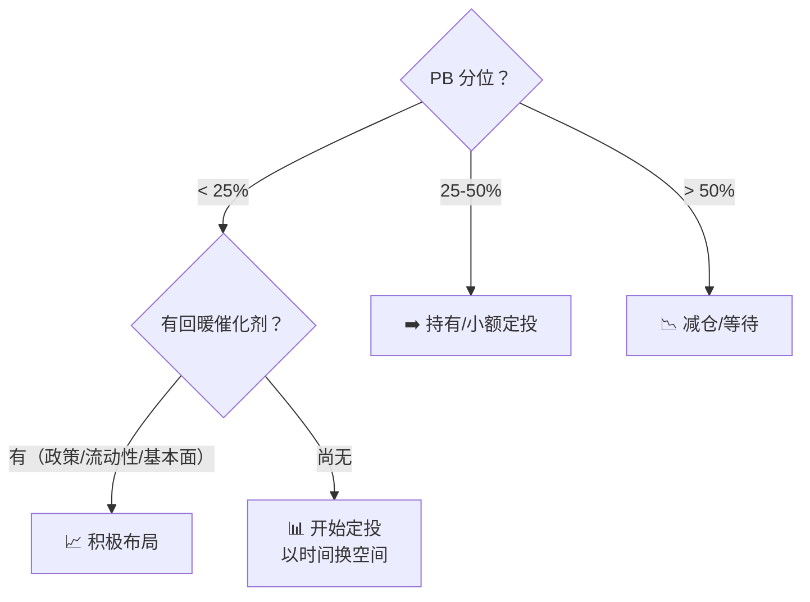

# ETF 与行业 ETF 估值

> 阶段三D 参考文档。ETF 是"一篮子股票"，和个股分析逻辑不同：不看护城河、不做杜邦拆解，核心是**指数估值分位 + 底层资产属性 + 仓位管理**。

---

## ETF 和个股的关键差异

| 维度 | 个股 | ETF |
|:---|:---|:---|
| 护城河 | 核心分析对象 | 不适用（篮子不挑公司） |
| ROE 杜邦 | 必须拆解 | 看指数整体 ROE 即可 |
| 管理层 | 重要 | 不适用 |
| 估值方法 | Gordon/PEG/正常化 PE | **指数 PE/PB 历史分位** |
| 风险 | 公司特有风险 | 系统性风险 + 行业风险 |
| 分红 | 看公司分红政策 | 看指数股息率 |
| 仓位 | 单个股上限严格 | 可适度高于个股（分散已内置） |

---

## 一、通用 ETF 估值框架

### 核心指标：估值分位

$$PE分位 = \frac{当前PE在历史PE中的排名}{历史数据总数} \times 100\%$$

### 组合倍数：先聚合，再比较

ETF 是一组按市值权重持有的资产。允许使用前十大成分估算代表 PB，但不能对成分股 PB 做算术平均，否则高 PB、低净资产权重的成分股会被严重放大。先按前十大权重归一化，再使用调和平均：

$$
PB_{top10} = \frac{C}{\sum_i \frac{w_i}{PB_i}}
$$

其中 `w_i` 是前十大成分股权重（%），`C` 是这些权重合计，也就是 `coverage_pct`；`PB_i` 是该成分股在 PB 估值日的 PB。该结果是前十大代表值，不是全指数精确值，报告必须保留覆盖率并说明口径。

错误示例：两只股票权重均为 50%、PB 分别为 0.5 和 8.0。

- 错误：`0.5×0.5 + 0.5×8.0 = 4.25`
- 正确：`1 / (0.5÷0.5 + 0.5÷8.0) ≈ 0.94`

组合总市值 ÷ 组合总净资产正是加权调和平均。另一个容易混淆的概念是 ETF 折溢价：`(ETF价格 ÷ 基金净值 - 1) × 100%`。ETF 价格低于净值只说明二级市场折价，不代表底层组合 PB 小于 1；反过来，ETF 溢价也不能证明底层 PB 大于 1。

每张 ETF 卡必须在 `markets[]` 写入可审计的 `etf_metrics`：

```json
{
  "index_code": "EXAMPLE",
  "index_name": "示例指数",
  "weight_method": "top10_market_cap_weighted_harmonic",
  "weight_as_of": "2026-09-30",
  "weight_source": "中证指数官方 closeweight",
  "coverage_pct": 88.0,
  "pb_as_of": "2026-10-23",
  "pb_source": "腾讯港股快照 PB 字段",
  "nav": 1.0,
  "nav_date": "2026-10-23",
  "nav_source": "基金净值接口",
  "premium_discount_pct": 0.0,
  "constituents": [
    {"code": "00001.HK", "name": "示例股票甲", "weight_pct": 50.0, "pb": 0.5},
    {"code": "00002.HK", "name": "示例股票乙", "weight_pct": 38.0, "pb": 8.0}
  ],
  "representative_pb": 0.8415
}
```

最多记录前十大成分，`coverage_pct` 必须等于所列权重合计。`pb_as_of` 和 `nav_date` 必须与 `markets[].price_date` 同日。`scorecard.py validate` 会复算前十大归一化调和平均、净值折溢价，并拒绝算术平均或覆盖率不一致的卡。

| PE/PB 分位 | 含义 | 操作方向 |
|:---|:---|:---|
| < 20% | 估值处于历史低位 | 📈 重点关注 |
| 20-40% | 偏低 | 📈 可考虑 |
| 40-60% | 中枢 | ➡️ 持有/观望 |
| 60-80% | 偏高 | 📉 减仓或等待 |
| > 80% | 估值处于历史高位 | 📉 回避或轻仓 |

### 估值分位的正确用法

**看至少 5 年历史**（覆盖一个完整牛熊周期）。3 年太短，可能只覆盖了牛市或熊市，分位失真。

**看 PE 和 PB 两个分位**——PE 受利润波动影响大（尤其周期行业 ETF），PB 更稳定。两者都处于低位时信号最可靠。

### 辅助指标

| 指标 | 用法 |
|:---|:---|
| **股息率 vs 国债** | ETF 股息率 > 国债 + 1% → 有吸引力 |
| **指数 ROE** | 整体 ROE > 10% → 底层资产质量过关 |
| **波动率** | 用于仓位计算（见仓位管理章节） |

---

## 二、宽基 ETF

### 代表

沪深 300 ETF、标普 500 ETF、恒生指数 ETF

### 分析逻辑

宽基 ETF 的分析最简单——就是**赌国运 + 估值回归**。

**Step 1：看 PE 历史分位**
- 当前 PE 处于近 10 年什么位置？
- 历史均值 PE 是多少？

**Step 2：计算预期收益**

$$预期年化收益 = 盈利增速 + 股息率 + 估值回归贡献$$

- 盈利增速 ≈ 名义 GDP 增速（宽基长期 ≈ 6-8%）
- 股息率 ≈ 当前指数股息率
- 估值回归 = (历史中枢 PE ÷ 当前 PE − 1) ÷ 回归年限

> 估值回归是**比值**口径，不是 PE 差值。中枢 12x、当前 10x、回归年限 5 年 → (12 ÷ 10 − 1) ÷ 5 = **+4%/年**（写成 (12−10)÷5 = 0.4 是量纲错误，会把回归贡献低估一个数量级）。
> 当前 PE **高于**中枢时这一项为**负**：当前 14x、中枢 12x、5 年 → −2.9%/年，直接压低合计收益——不要只算正贡献。

**Step 3：判断**

| PE 分位 | 预期年化 | 操作 |
|:---|:---:|:---|
| < 20% | > 12% | 积极配置 |
| 20-40% | 9-12% | 标准配置 |
| 40-60% | 6-9% | 持有 |
| > 60% | < 6% | 减配 |

---

## 三、行业 ETF

### 分析框架

行业 ETF 需要**两层判断**：

1. **行业周期位置**（和周期个股的逻辑类似）
2. **指数估值分位**（PE/PB 在历史什么位置）

两者共振时才出手。

### 行业分类及估值重点

| 行业 ETF 类型 | 代表 | 核心估值指标 | 特别关注 |
|:---|:---|:---|:---|
| **消费行业** | 消费 ETF、食品饮料 ETF | PE 分位 + 股息率 | ROE 稳定性，龙头权重 |
| **医药行业** | 医药 ETF、创新药 ETF | PE 分位 + 管线景气 | 集采政策风险 |
| **科技行业** | 科技 ETF、芯片 ETF | PS 分位 + PEG | 景气周期，估值波动大 |
| **金融行业** | 证券 ETF、银行 ETF、香港证券 ETF | PB 分位 + ROE | 详见下方"金融类 ETF"专项 |
| **周期行业** | 有色 ETF、煤炭 ETF、钢铁 ETF | PB 分位 + 商品价格 | 强周期，必须看商品位置 |
| **红利/高股息** | 红利 ETF、中证红利 | 股息率 vs 国债 + PB 分位 | 本质是"债券替代品" |
| **跨境 ETF** | 恒生 ETF、纳指 ETF | PE 分位 + 汇率 | 汇率风险额外计算 |

---

## 四、金融类 ETF 专项分析

这是你最关心的类型，以**香港证券 ETF**为例展开。

### 金融类 ETF 的底层特征

香港证券 ETF 的底层主要是：港交所 + 中资券商 + 内资银行 + 保险。本质上是**"自带杠杆的周期型篮子"**——牛市业绩爆发，熊市业绩萎缩。

### 核心估值：PB 分位

金融类 ETF **看 PB 比看 PE 更重要**。原因：金融企业的利润（E）波动极大，净资产（B）相对稳定。

| PB 分位 | 含义 | 历史参考（香港证券类） |
|:---|:---|:---|
| < 10% | 极度悲观——通常对应市场底部 | 2016 年初、2020 年 3 月、2022 年 10 月 |
| 10-25% | 低估区间 | 值得开始关注和分批布局 |
| 25-50% | 偏低至中枢 | 已有持仓的持有，新资金等待 |
| 50-75% | 中枢至偏高 | 减仓区域 |
| > 75% | 乐观——通常对应牛市高潮 | 2015 年中、2021 年初 |

### 分析步骤

**Step 1：看 PB 历史分位（近 10 年）**

```
当前 PB = ______ 倍
近 10 年 PB 最低 = ______ 倍，最高 = ______ 倍，中位数 = ______ 倍
当前处于 ______ 分位
```

**Step 2：看底层资产质量**

| 底层成分 | 当前状态 | 关注指标 |
|:---|:---|:---|
| 券商 | 牛市/熊市/震荡 | 日均成交额、两融余额、IPO 节奏 |
| 银行 | 息差趋势、不良率 | 行业平均 PB、ROE |
| 保险 | 保费增速、投资收益 | P/EV、NBV 增速 |
| 港交所 | ADT（日均成交额） | 独特性——垄断地位 |

**Step 3：看宏观催化剂**

| 信号 | 利好 | 利空 |
|:---|:---|:---|
| 利率 | 利率上行有利银行保险 | 利率下行压缩息差 |
| 市场情绪 | 成交额放大、IPO 活跃 | 成交萎缩、破发潮 |
| 政策 | 资本市场改革、互联互通深化 | 监管收紧 |
| 港股通资金 | 持续净流入 | 持续净流出 |

**Step 4：综合判断**



### 金融类 ETF 估值速算

| 当前 PB 分位 | 建议仓位（占金融类配置） | 预期收益（3 年维度） |
|:---|:---:|:---:|
| < 10% | 80-100% | 年化 15-25% |
| 10-25% | 50-80% | 年化 10-18% |
| 25-50% | 20-50% | 年化 5-12% |
| 50-75% | 0-20% | 年化 0-8% |
| > 75% | 0% | 年化 < 0%（下行风险大） |

---

## 五、ETF 定投策略（针对高波动品种）

对于金融类 ETF 这种高波动品种，**定投 + PB 分位加码**是更务实的策略。

### 定投加码规则

| PB 分位 | 定投倍数 |
|:---|:---:|
| < 10% | 2.0×（加倍） |
| 10-25% | 1.5× |
| 25-50% | 1.0×（正常） |
| 50-75% | 0.5×（减半） |
| > 75% | 0×（暂停，考虑赎回） |

### 止盈规则

| PB 分位 | 操作 |
|:---|:---|
| > 70% | 卖出 1/3 |
| > 80% | 再卖 1/3 |
| > 90% | 清仓 |

---

## 六、ETF 与个股在组合中的分工

| | 个股（稳定型） | 个股（周期型） | ETF（宽基） | ETF（行业/金融） |
|:---|:---|:---|:---|:---|
| **分析深度** | 深 | 深 | 浅 | 中 |
| **持有周期** | 3-5 年+ | 1-3 年 | 长期 | 1-3 年 |
| **核心价值** | 复利增长 | 逆周期弹性 | 市场贝塔 | 行业贝塔+估值回归 |
| **适合角色** | 核心仓位 | 卫星仓位 | 底仓配置 | 战术配置 |

> 本 skill 不估计个股或 ETF 的仓位数量及上限；只描述买入计划内部的分批节奏。
