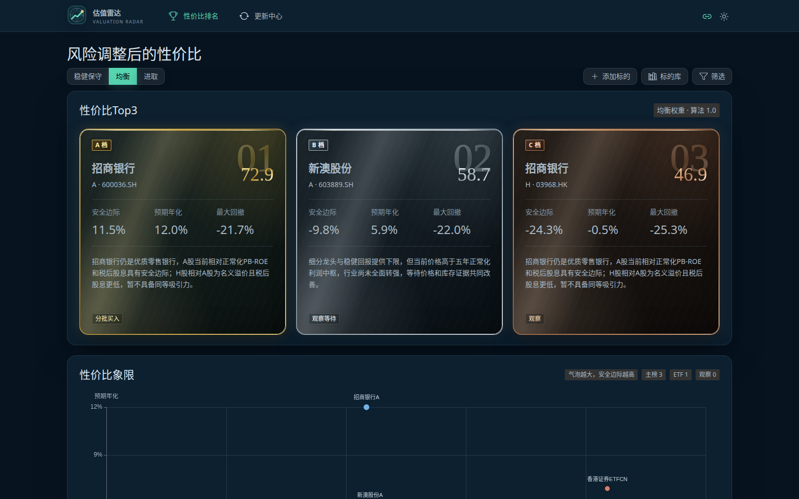
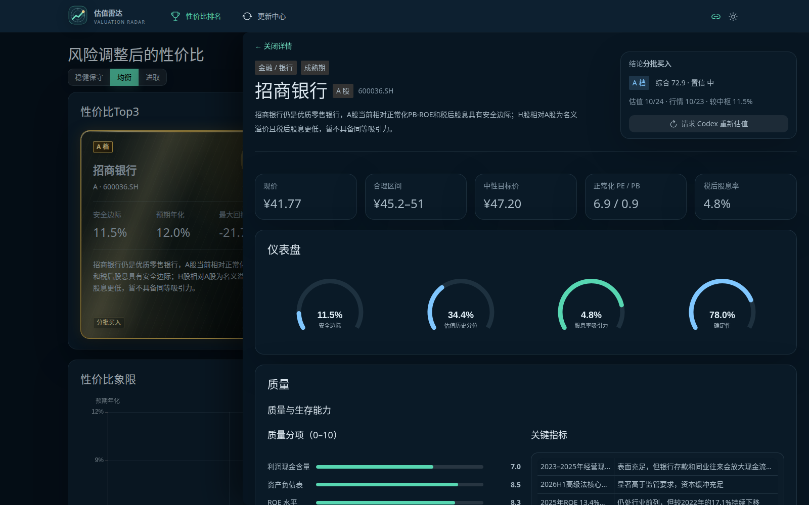
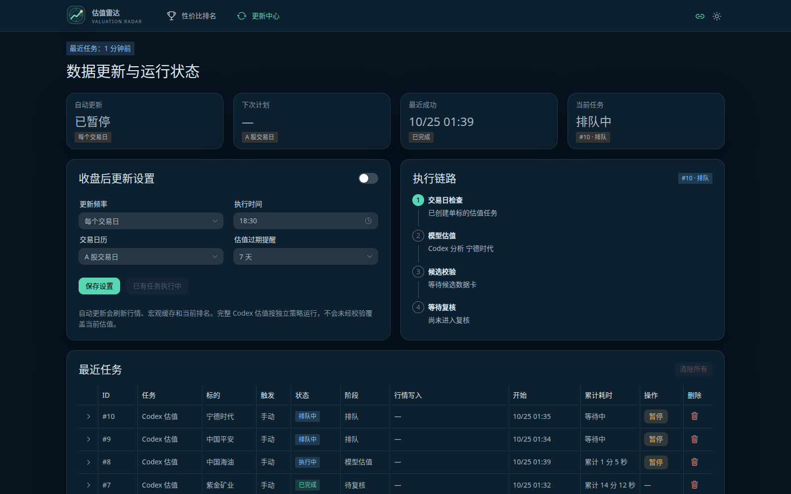
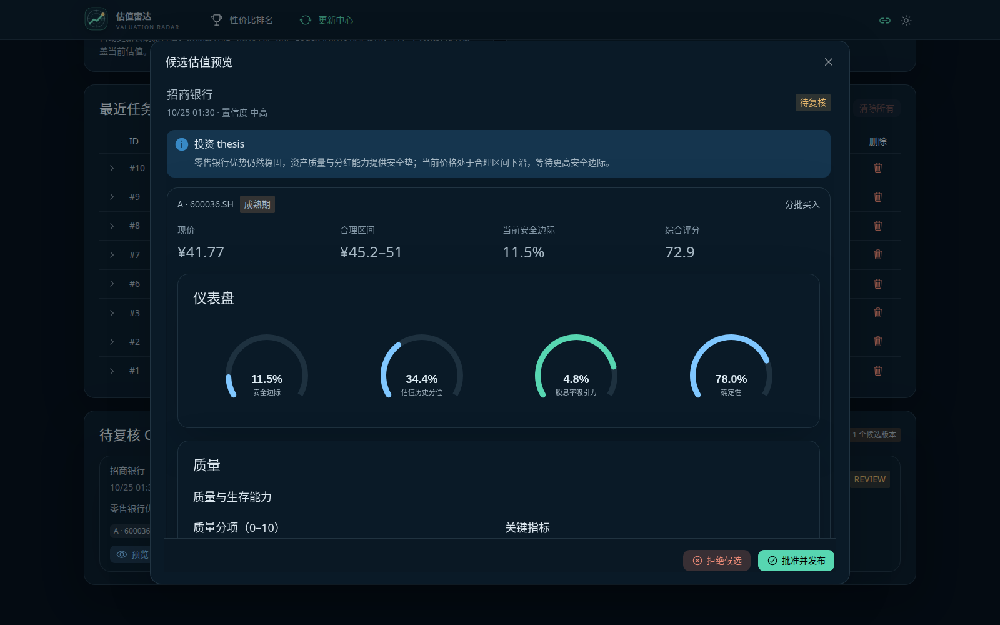

<p align="center">
  <a href="./README.md"><strong>简体中文</strong></a>
  &nbsp;|&nbsp;
  <a href="./README.en.md">English</a>
</p>

# 估值雷达

估值雷达是一个以 AI 估值能力为核心、带完整 Web 界面的价值投资研究工作台。项目通过 Codex 驱动的估值流程，对个股与 ETF 进行系统化研究与估值，并结合市场行情、风险偏好和预期收益生成多套排名；估值过程、数据依据、候选结果与历史版本均可在 Web 应用中查询、复核和追溯。

本机优先的估值分析工作台。项目把估值数据卡、三套风险偏好排名和估值报告升级为可查询、可追溯、按交易日更新的 Web 应用。

项目以 [GNU General Public License v3.0](LICENSE)（`GPL-3.0-only`）开源。第三方依赖、模型服务和行情数据源仍分别适用各自的许可证与服务条款，详见 [依赖说明](docs/DEPENDENCIES.md)。

## 适用市场与环境

当前项目主要在 A 股市场和 Linux 环境中开发和验证。AI 估值逻辑本身不挑市场，但非 A 股市场及非 Linux 环境尚未经过测试；相关组合在逻辑上可能可用，使用前请自行验证并承担风险。

项目基于长线价值投资逻辑，强调以合理或便宜的价格买入好公司并长期持有，不适合短线投机使用。

## 界面预览

### 性价比排名



### 同页估值详情



### 数据更新与运行状态



### 候选估值预览



## 已实现

- Vue 3 排名首页：稳健保守 / 均衡 / 进取三套榜单、Top 3、象限图、筛选和完整排名。
- 同页完整估值详情：点击排名后在当前页面展开，包含合理区间、当前安全边际、收益拆解、四维评分、仓位、风险和 A/H 对照。
- SQLite 数据层：历史估值版本、市场快照、行情、宏观数据、排名快照、任务和 AI 运行记录。
- 收盘后自动更新：交易日历、可配置开关/频率/时间、行情抓取、任务幂等和排名重算。
- Codex 持久会话：首次运行保存 `thread_id`，暂停、中断或服务重启后通过 `codex exec resume` 续接原会话和工作目录，避免重复取证与计算。
- 任务生命周期：估值任务支持暂停、恢复、单任务删除和累计执行时间；删除运行中任务时会先终止 Codex 进程组，再清理任务记录和暂存目录。
- Codex 估值闭环：隔离暂存目录调用 `value-investing` skill，Python 校验后进入人工复核队列；同一任务的多轮执行在 Debug 中合并为一个逻辑会话，同时保留逐次运行的审计明细。
- 候选复核：待复核卡片先进入完整估值预览，批准、拒绝按钮固定在预览底部；已拒绝候选支持预览、重新估值和永久删除。
- ETF 数据约束：校验前十大成分权重、代表 PB 的调和平均、净值与价格同步日期、折溢价率及章节展示契约，减少不可审计的 ETF 估值结果。
- 手动添加标的：主页可按名称创建估值任务，证券代码可选；未提供代码时由 Codex 检索市场，A/H 两地上市默认同时调研。
- 标的生命周期：标的库支持移出榜单、恢复和输入名称确认后的彻底删除；归档保留全部估值历史，彻底删除同步清理关联任务与暂存目录。

## 技术栈

- 前端：Vue 3、TypeScript、Vite、Vue Router、Naive UI 默认暗色主题、TanStack Vue Query、ECharts
- 后端：FastAPI、Pydantic v2、SQLAlchemy 2、Alembic
- 数据库：SQLite（WAL）
- 调度：独立 scheduler + 单实例 worker + 数据库任务表
- 模型（可选）：Codex CLI `exec`，工作目录沙箱，不直接写生产数据库

架构细节见 [docs/architecture.md](docs/architecture.md)，数据卡契约见
`.codex/skills/value-investing/references/card-v1.2.schema.json`。

视觉样式统一由 `apps/web/src/theme.ts` 和 `apps/web/src/styles/` 管理：主题 token、页面布局和少量品牌组件样式分别集中，不在页面组件中散落自定义视觉规则。

## 文档导航

| 文档 | 用途 |
|---|---|
| [Quick Start](docs/QUICKSTART.md) | 从零安装依赖、初始化数据库并启动本地服务 |
| [依赖说明](docs/DEPENDENCIES.md) | 开发环境版本、锁文件、外部服务与许可证边界 |
| [Codex Skill 安装](docs/CODEX_SKILLS.md) | 项目级/全局 Skill 安装、登录与验证 |
| [开发运维](docs/runbook.md) | 本地状态检查、任务处理与数据库迁移 |
| [系统架构](docs/architecture.md) | 进程、数据边界与 Codex 估值任务链路 |

## TODO

- [ ] 增加 Web 界面中英文语言切换，覆盖导航、表单、状态、错误提示、日期与数字格式。
- [ ] 评估估值报告正文与章节标题的双语数据契约和模型输出方案。

## Quick Start

基础界面、数据导入、排名和行情刷新需要 Python 3.12、Node.js 22+、pnpm 11.10 和 SQLite。只有在 Web 中发起 Codex 估值时才需要已安装并登录的 Codex CLI。

```bash
pnpm run bootstrap
pnpm dev
```

访问：

- Web：<http://127.0.0.1:5173>
- API：<http://127.0.0.1:8000>
- OpenAPI：<http://127.0.0.1:8000/docs>

完整的系统依赖安装、Codex 登录、Skill 安装、示例数据导入和常见问题见 [Quick Start](docs/QUICKSTART.md)。

## 常用命令

```bash
pnpm dev             # API、Web、worker、scheduler
pnpm test            # 后端与前端单元测试
pnpm test:e2e        # Edge 桌面/手机端到端测试
pnpm lint            # Ruff + ESLint
pnpm typecheck       # mypy + vue-tsc
pnpm build           # 生产前端构建
pnpm db:migrate      # 执行 Alembic 迁移
pnpm import:legacy   # 重复导入是幂等的
```

## 数据流

```text
data/*.json
        ↓ 导入与校验
SQLite 历史估值版本
        ↓ 四维评分
三套排名快照

交易日收盘后 → scheduler → job_runs → worker
                                  ├─ 行情/宏观写入 → 排名重算
                                  ├─ Codex 持久会话 ─┬─ 暂停 / 恢复
                                  │                   ├─ 中断后续接
                                  │                   └─ 终止并删除
                                  └─ 候选估值校验 → 预览复核
                                                       ├─ 批准 → 发布并重算排名
                                                       └─ 拒绝 → 保留或删除
```

最新行情只改变“当前安全边际”和排名，不改写历史合理中枢。Codex 结果批准前不会进入当前排名。暂停、中断和恢复不会重置累计执行时间；只有当前工作目录或持久会话不可用时，才会回退为新的 Codex 会话。

## 数据与安全

- Web 开发服务器监听 `0.0.0.0`，允许同一局域网内访问；API 仍仅监听 `127.0.0.1`，浏览器请求通过 Vite 的 `/api` 代理转发。
- 数据库、日志、归档和暂存目录均被 Git 忽略。
- 模型在 `storage/staging/` 隔离目录执行，使用 `workspace-write` 沙箱。
- Codex 会话由本机 Codex CLI 持久化；任务删除会终止对应进程组并清理任务暂存目录。
- 新估值的必需数据缺失时立即终止，不生成或发布候选卡；历史卡只做只读兼容。
- 应用目前没有内置身份认证，只应在本机开发环境使用，不要暴露到公网。
- 行情、宏观数据和模型输出受外部服务可用性、账户权限及使用条款约束。
- 所有分析结果仅用于研究，不构成投资建议。

## 鸣谢

估值雷达的发展离不开以下个人与项目的支持：

- 感谢 [Codex](https://openai.com/codex/) 在估值流程设计和工程开发中的协作支持。
- 感谢梁叔叔提供 [DeepSeek](https://www.deepseek.com/) 支持。
- 感谢 [Vue](https://vuejs.org/) 与 [Naive UI](https://www.naiveui.com/) 提供可靠、易用的前端基础设施。

## 欢迎加入开发

欢迎所有对价值投资工具、AI 估值、前端体验、后端工程或文档建设感兴趣的朋友加入估值雷达的开发。你可以先阅读 [Quick Start](docs/QUICKSTART.md) 并在本地运行项目，再通过 Issue 讨论需求，或提交聚焦明确、带有必要测试和文档的 Pull Request。

## 许可证

Copyright (C) 2026 估值雷达贡献者。

本项目仅依据 GNU General Public License v3.0（SPDX：`GPL-3.0-only`）授权，不自动适用任何更高版本。你可以按照 [LICENSE](LICENSE) 的条款使用、修改和分发本项目；分发修改版本时需同时满足 GPL 的源代码提供要求。若未另行注明，提交到本项目的贡献也按同一许可证授权。
