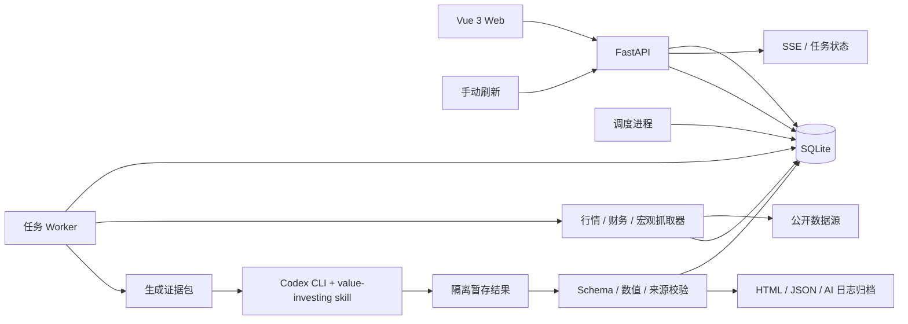

# 估值分析 Web 应用开发计划

> 版本：v1.0
> 编制日期：2026-10-21
> 状态：待启动
> 目标读者：产品负责人、开发实现者、日常使用者

## 1. 项目目标

建设一个本机优先、可持续维护的估值分析 Web 应用，把当前分散的估值 HTML 报告和 `data/*.json` 数据卡升级为可查询、可比较、可追溯、按交易日更新的产品。

首版需要完成以下闭环：

1. 首页展示当前投资性价比排名，可切换“稳健保守 / 均衡 / 进取”三套风险偏好。
2. 排名项可点击进入动态估值详情，不依赖解析旧 HTML。
3. Python 固化行情、财务、宏观和公告数据的抓取、校验、估值计算与排序。
4. 数据、估值版本、排名版本、任务记录和审计信息进入数据库。
5. 每个交易日收盘后可自动更新行情与排名；更新频率、执行时间、范围、估值刷新策略和总开关可在 Web 设置。
6. 定性判断、估值路径选择、周期定位和情景假设等无法可靠脚本化的部分，由 Codex 调用现有 `value-investing` skill 完成。
7. 模型输出与确定性数据分层校验，校验失败或用户未启用模型任务时，继续保留最近一次可信结果。
8. 工程代码放入独立的 `valuation-web/` 目录并初始化 Git，按开发阶段拆分提交。

## 2. 当前基线

当前工作区已经具备良好的数据和规则基础：

- `data/` 下有 21 张数据卡，覆盖 19 家公司/标的、29 个“标的 × 市场”排序单元。
- 其中 A 股 16 条、H 股 11 条、ETF/中国市场 2 条。
- 已有 21 份同源 HTML 估值报告。
- `common/` 已缓存 10 年期国债收益率、汇率和恒生 AH 溢价指数。
- `investment-ranking` skill 已定义四维评分、三套权重、门槛和分档规则。
- 本机有 `node`、`pnpm`、Python 3.12 和 Codex CLI 0.162.1。
- 当前目录还不是 Git 仓库，开发前需要初始化版本控制。
- 福耀玻璃有三张不同日期的数据卡，迁库时必须保留历史并只把最新版本用于当前详情。
- 新项目使用 `valuation-web/` 作为独立 Git 仓库；现有数据与报告目录继续作为只读导入源。

现有文件的分工应继续保持：

```text
data/*.json                      结构化估值事实卡，兼容和审计格式
*_估值分析_YYYY-MM-DD.html      完整离线估值报告，归档产物
投资性价比排序_YYYY-MM-DD.html  当前排序的离线导出样板
common/*.json                    跨标的市场数据缓存
```

数据库将成为 Web 应用的运行时事实源；JSON 和 HTML 保留为导入、导出、审计和离线阅读格式，不作为前端实时查询的唯一来源。

## 3. 范围

### 3.1 首版范围

- 当前估值池迁移、历史版本保留和最新版本选择。
- 三套风险偏好排名、筛选、排序、搜索。
- 动态估值详情、历史变更、同公司 A/H 对照、原报告查看。
- 行情与宏观定时更新。
- 排名每日重算与历史快照。
- Codex 估值任务队列、隔离执行、结果校验和发布审批。
- 定时任务设置、手动刷新、运行状态、错误展示。
- 数据新鲜度和“估值基线偏旧”提示。
- 单元、接口、端到端测试和本地运行文档。

### 3.2 暂不纳入首版

- 自动下单、券商账户接入和交易执行。
- 实时盘口和分钟级行情。
- 多用户权限、云端 SaaS、公网多租户。
- 组合持仓成本、税务账本和复杂再平衡。
- 自动发布未经确定性校验的模型结果。
- 对历史报告做反向解析来恢复缺失字段。

## 4. 核心架构决策

| 决策 | 选择 | 原因 |
|---|---|---|
| 前端 | Vue 3 + TypeScript + Vite | 组合式 API 清晰、交互丰富；无需 SSR；与 Python API 解耦；构建产物可由 FastAPI 或本机静态服务器托管 |
| 后端 | FastAPI + Pydantic v2 | 类型清晰、OpenAPI 自动生成、适合定时任务与异步接口组合 |
| ORM/迁移 | SQLAlchemy 2.0 + Alembic | 数据模型可维护，后续可迁移 PostgreSQL |
| 数据库 | SQLite（WAL 模式） | 本机单用户、零运维；足以支撑数十到数百标的 |
| 数据访问 | 后端仓储层 + 纯领域服务 | 估值和评分不依赖 Web 框架，便于测试与复核 |
| 调度 | APScheduler + 数据库任务表 | 不引入 Redis/Celery；单机部署简单；任务状态持久、可审计 |
| 前端数据层 | TanStack Vue Query + 生成的 TypeScript API 客户端 | 缓存、失效、轮询和错误状态统一 |
| 图表 | Apache ECharts | 支持象限图、区间带、堆叠收益、历史折线和交互筛选 |
| 模型执行 | Codex CLI `exec` + 隔离暂存目录 | 直接复用现有 skill，不复制一套私有提示词系统 |
| 报告运行时 | 数据库动态渲染；旧 HTML 作为归档附件 | 页面可交互；不受旧 HTML 结构变化影响 |

首版坚持本机单用户部署，服务默认只监听 `127.0.0.1`。如果后续需要局域网访问，再加入身份认证、HTTPS 和 CSRF 防护。

## 5. 总体架构



运行单元分为四个进程：

1. `web`：静态前端开发服务器或构建后的文件服务。
2. `api`：FastAPI，只负责查询、配置和提交任务。
3. `scheduler`：读取数据库中的计划，在交易日收盘后投递任务。
4. `worker`：执行数据抓取、估值编排、Codex 调用、校验和入库。

开发时由根目录脚本统一启动；本地生产部署使用单 API worker、单任务 worker、单调度器，避免 SQLite 写竞争和重复任务。

## 6. 建议目录结构

```text
.
├── apps/
│   ├── api/
│   │   ├── pyproject.toml
│   │   ├── alembic/
│   │   ├── app/
│   │   │   ├── main.py
│   │   │   ├── api/v1/
│   │   │   ├── core/
│   │   │   ├── db/
│   │   │   ├── models/
│   │   │   ├── repositories/
│   │   │   ├── schemas/
│   │   │   ├── domain/
│   │   │   │   ├── valuation/
│   │   │   │   ├── scoring/
│   │   │   │   └── freshness/
│   │   │   ├── providers/
│   │   │   ├── services/
│   │   │   ├── jobs/
│   │   │   └── integrations/codex/
│   │   └── tests/
│   └── web/
│       ├── src/
│       │   ├── api/
│       │   ├── components/
│       │   ├── features/
│       │   ├── routes/
│       │   ├── styles/
│       │   └── test/
│       └── e2e/
├── packages/
│   └── contracts/
├── data/
├── common/
├── storage/
│   ├── artifacts/
│   ├── staging/
│   ├── backups/
│   └── logs/
├── docs/
│   └── adr/
├── scripts/
├── pnpm-workspace.yaml
├── package.json
├── Makefile
├── .env.example
└── README.md
```

`storage/` 中的运行产物加入 `.gitignore`；数据卡、迁移脚本、规则文档和测试夹具进入版本控制。

## 7. 数据模型

### 7.1 建模原则

- 公司/标的与上市市场分开建模，排序单元始终是“标的 × 市场”。
- 一次估值报告是不可变版本；修订产生新版本，不原地覆盖。
- 核心可查询数值使用独立列；完整原始数据卡以 JSON 快照保留。
- 行情、宏观事实和估值结论分开存储，便于展示各自时效。
- 排名结果按每次运行固化，保存当时使用的配置、输入摘要和算法版本。
- 所有业务日期按 `Asia/Shanghai` 解释，时间戳统一以 UTC 存储、API 输出 ISO 8601。

### 7.2 核心表

| 表 | 作用 | 关键字段 |
|---|---|---|
| `instruments` | 公司或 ETF 主数据 | `name`、`asset_type`、`path`、`industry`、`cycle_stage`、`enabled` |
| `listings` | 标的在各市场的上市记录 | `instrument_id`、`market`、`code`、`currency`、`enabled` |
| `valuation_reports` | 一次估值报告版本 | `analysis_date`、`revision`、`quality`、`conclusion`、`source`、`algorithm_version`、`status` |
| `valuation_markets` | 报告中分市场的估值结果 | `report_id`、`listing_id`、价格、合理区间、PE/PB、安全边际、预期收益、回撤、仓位 |
| `quote_observations` | 行情快照 | `listing_id`、`observed_at`、`quote_date`、价格、PE/PB、来源 |
| `macro_observations` | 利率、汇率、AH 溢价等市场数据 | `key`、`as_of`、`value`、`source`、`fetched_at` |
| `fundamental_observations` | 财务和经营事实 | 标的、报告期、指标、数值、单位、来源 |
| `source_observations` | 原始响应和证据留痕 | 来源、URL、抓取时间、内容哈希、响应摘要/文件路径 |
| `ranking_runs` | 一次排名计算 | `as_of`、`profile`、配置哈希、算法版本、输入摘要 |
| `ranking_entries` | 排名明细 | `run_id`、`listing_id`、分数、档位、名次、排除原因 |
| `schedule_settings` | 刷新配置 | 开关、频率、交易日模式、执行时间、范围、模型策略 |
| `job_runs` | 可执行任务及状态 | 类型、触发方式、业务日期、幂等键、状态、错误摘要 |
| `job_events` | 任务结构化日志 | 任务、阶段、级别、消息、时间 |
| `ai_runs` | Codex 运行记录 | prompt/证据哈希、CLI 版本、模型、退出码、耗时、输出路径、审批状态 |
| `artifacts` | HTML、JSON、日志等产物 | `report_id`、类型、路径、SHA-256、大小 |
| `provider_health` | 数据源健康度 | 来源、最近成功、失败率、连续失败数、熔断状态 |
| `app_settings` | 非敏感的全局设置 | 新鲜度阈值、自动发布策略、并发数 |

核心表使用外键、检查约束和必要索引。完整原始数据卡另存为不可变 JSON 附件，保证将来 schema 演进时不丢信息。

### 7.3 版本和发布状态

估值报告状态机：

```text
draft -> validating -> needs_review -> published
                     \-> rejected
published -> superseded
```

- `published`：已通过自动校验，可作为当前排名输入。
- `needs_review`：数值变化过大、来源不足或模型结论异常，不替换当前版本。
- `rejected`：schema、公式、日期、标的或产物校验失败。
- `superseded`：已被更可信的新报告替换，但历史仍可查询。

同一标的同一分析日允许存在修订版本，用 `(instrument_id, analysis_date, revision)` 唯一约束。任何更新都不删除旧版本。

## 8. 初始化迁移

开发第一阶段要完成一次性迁移工具：

1. 扫描 `data/*.json` 和根目录估值 HTML。
2. 使用现有 `scorecard.py validate` 校验数据卡。
3. 按 `name` 聚合标的，保留所有分析日期和历史版本。
4. 同一标的选 `analysis_date` 最新，日期相同再按 `generated_at` 最新，作为当前版本。
5. 将 HTML 复制或软链入 `storage/artifacts`，记录 SHA-256。
6. 将排名重算结果与 `investment-ranking/scripts/rank.py --json` 做全量对照。
7. 迁移可重复执行，以内容哈希和自然键保证幂等。

迁移验收要求：

- 导入 21 张现有数据卡。
- 形成 19 个标的、29 个市场排序单元。
- 福耀玻璃三个版本均保留，只有 2026-10-21 版本为当前版本。
- 所有数据卡通过现有 schema 校验。
- 排名、分档、排除原因和三套总分与 skill 脚本一致。

## 9. 估值与数据分层

### 9.1 Python 固化范围

确定性、可测试的工作全部放在 Python：

- 行情、宏观、财务、公告元数据抓取。
- A/H 字段映射、复权、日期和币种校验。
- 收益率、增长率、TTM、分位、安全边际等计算。
- 稳定型、周期型、金融型、ETF 和跨市场估值的公式引擎。
- 数据门槛、估值门槛、排序、分档和风险标签。
- 输入哈希、幂等、缓存、重试、熔断和原始响应归档。
- JSON schema、数值闭合、单位、区间和产物完整性校验。

建议的领域模块：

```text
domain/valuation/
├── common.py      安全边际、年化收益、情景、门槛、单位
├── stable.py      Gordon 反推、PEG、分红与增长
├── cyclical.py    正常化利润、PE/PB/EV/EBITDA、周期位置
├── financial.py   PB-ROE、P/EV、NBV
├── etf.py         指数估值分位、股息、定投指标
└── ah_cross.py    名义溢价、税负、贴现率、结构性溢价、残余
```

每个公式模块接受 Pydantic 输入模型，返回 Pydantic 输出模型，不读取数据库、不发网络请求。数据库和 HTTP 由服务层负责。

### 9.2 Codex 承担范围

以下工作保留给模型判断，但要求输出结构化依据：

- 产业生命周期和周期位置定性判断。
- 商业模式、护城河、会计质量和治理风险评价。
- 估值路径选择及不适用的理由。
- 正常化盈利、增长率、合理倍数和情景假设。
- A/H 市场分割、流动性和投资者税负差异的解释。
- 风险传导链、关键反证和置信度。
- 基于 skill 模板生成完整 HTML 估值报告。

模型不能直接写生产数据库。它只在隔离目录生成“候选结果”，由 Python 校验后导入。

### 9.3 两类计算的边界

为避免模型口算错误，采用“双层计算”：

1. Codex 按 skill 生成候选数据卡和报告。
2. Python 独立重算安全边际、收益分项合计、合理区间逻辑、排名所需字段。
3. 重算值与数据卡不一致时：
   - 小额差异按显式舍入规则记录。
   - 实质差异使结果进入 `needs_review`，不自动覆盖当前版本。

## 10. 数据抓取设计

### 10.1 Provider 接口

每个数据源实现统一适配器，而不是在业务代码里散落 URL：

```python
class MarketDataProvider(Protocol):
    def quote(self, listings: list[ListingRef], as_of: date) -> list[Fact]: ...
    def history(self, listing: ListingRef, start: date, end: date) -> list[Fact]: ...

class FilingProvider(Protocol):
    def filings(self, instrument: InstrumentRef, since: datetime) -> list[FilingRef]: ...
```

首版建议组合：

- A/H 实时或收盘行情：腾讯财经接口为主，备用公开行情源交叉核对。
- 财务与历史行情：东方财富/公开接口，优先通过 `akshare` 等稳定封装访问。
- A 股公告：巨潮资讯。
- H 股公告：港交所披露易。
- 宏观：沿用并校验 `common/` 中的国债、汇率和 HSAHP 缓存。
- 指数与 ETF：底层指数估值、成分和分位优先使用可复核的公开指数/基金数据。

具体 endpoint 和字段映射必须在 Phase 0 用当前网络环境做连通性验证，并固化成 fixture。任何单一来源都可能变更，因此不得让业务逻辑直接依赖响应下标。

### 10.2 抓取约束

- 统一超时、有限重试、指数退避和来源级限速。
- 连续失败触发短期熔断，任务标记 `partial`，继续处理其他标的。
- 原始响应保留哈希、抓取时间、来源 URL 和必要的响应体。
- 关键行情/PE/ROE 至少两个来源交叉验证；无法双源时明确降低置信度。
- 缺失值写 `null` 并登记到 `missing`，不得用 0 或猜测值补齐。
- 遵守数据源条款、robots 约束和访问频率限制，不绕过登录或付费墙。

### 10.3 单位与日期

- 所有百分比字段继续采用“数值即百分数”，如 `4.72` 表示 4.72%。
- 价格、金额保存业务币种，另存明确 `currency`。
- `price_date`、`analysis_date` 是业务日期；`fetched_at`、`observed_at` 是抓取时间。
- 价格安全边际用同币种价格与合理中枢计算，不做不必要的汇率换算。
- A/H 对比时才使用汇率，并单独展示汇率日期。

## 11. 每日更新与估值刷新

### 11.1 两种刷新节奏

“每日更新数据”与“重新做完整估值”不是同一件事。首版采用双层策略：

| 任务 | 默认频率 | 内容 | 成本 |
|---|---|---|---|
| 市场刷新 | 每个交易日收盘后 | 行情、汇率、利率、AH 溢价、排名重算 | 低、确定性高 |
| 全量重估 | 每周或事件触发 | 财务核验、周期判断、合理中枢、Codex 报告 | 高、需要模型 |

默认在 `Asia/Shanghai` 每个 A 股交易日 18:30 执行市场刷新，周末和交易所休市日跳过。H 股独有标的可在配置中启用对应市场日历。

完整重估的默认触发条件：

- 距上次重估达到 7 个自然日。
- 出现新财报、业绩预告、分红方案、重大公告或除权除息。
- 中美国债收益率发生显著变化。
- 当前价相对上次估值日大幅变化。
- 用户对单标的点击“重新估值”。

用户可以在设置中把“全量重估”改为每个交易日、每周、仅事件触发或关闭。每日行情更新和排名重算仍可独立开启。

### 11.2 行情更新后的排名

估值报告中 `fair_mid` 代表某次估值基线，不能因为行情变化而静默改写历史报告。

每次排名运行独立计算：

```text
当前安全边际 = (估值基线 fair_mid - 当前价) / fair_mid × 100%
```

排名明细同时保存：

- 估值基线价格与安全边际。
- 当前价格和当前安全边际。
- 估值报告日期、行情日期和无风险利率日期。

详情页同时展示“估值基线”和“按当前价折算”，避免让用户误以为合理中枢每天重算。

### 11.3 调度与幂等

- 调度器每分钟检查配置和交易日历，只在目标时间窗口投递一次。
- 幂等键建议为 `job_type + scheduled_for + scope_hash`。
- 任务使用数据库租约锁，保证单 worker 不重复执行。
- 使用 `coalesce=True`，机器重启后错过的任务最多补跑一次。
- 所有任务有阶段日志：`queued`、`fetching`、`ranking`、`ai_queued`、`validating`、`completed`、`failed`。
- 单标的失败不阻断其他标的；整轮任务可以是 `partial`。
- 最近一次成功发布的数据必须一直可读，失败任务不能清空现有排名。

### 11.4 新鲜度规则

默认建议：

- 行情：以最近一个已收盘交易日为正常；超过 1 个交易日提示警告。
- 宏观：超过 3 个自然日提示警告。
- 估值报告：超过 7 个自然日提示“估值偏旧”。
- 排名：市场刷新成功后应立即更新；超过 1 个交易日提示失败或未调度。

阈值写入配置，不能散落在前端。页面必须同时显示“行情时间”“估值时间”“排名时间”和“下次计划时间”。

## 12. Codex / LLM 集成

### 12.1 为什么用隔离暂存目录

Codex 具备执行命令和修改文件的能力。model 输出不是可信事务，不能直接写生产库或覆盖当前报告。每次 Codex 任务在独立目录运行：

```text
storage/staging/{job_id}/{instrument_slug}/
├── prompt.md
├── evidence.json
├── evidence.md
├── previous_card.json
├── changes.json
├── common/
├── data/
└── result/
```

Python 先抓取并整理证据包，模型只在受控目录内读取和写入。任务结束后由导入器复制已验证产物，不把整个暂存目录同步进主目录。

### 12.2 Codex 调用方式

使用非交互模式，例如：

```bash
codex exec \
  --ephemeral \
  --json \
  --skip-git-repo-check \
  --sandbox workspace-write \
  --output-schema storage/staging/<job_id>/manifest.schema.json \
  --output-last-message storage/staging/<job_id>/result/manifest.json \
  -C storage/staging/<job_id>/<instrument_slug> \
  "$(cat prompt.md)"
```

不启用 `--dangerously-bypass-approvals-and-sandbox`。如果自动化环境要求审批策略，优先使用 `--approve-for-me` 并通过测试确认；若权限仍无法闭环，先修运行边界，不降低沙箱等级。

建议 Phase 0 验证：

- Codex CLI 能看到全局的 `value-investing` skill。
- 非交互进程能读取暂存目录。
- 网络策略是“默认关闭”；只有用户启用研究模式时才允许受限联网。
- 超时、退出码、JSONL 日志和输出文件都能被 Python 捕获。
- 失败时不会残留半发布数据。

### 12.3 Prompt 约束

每个任务 prompt 必须包含：

- 明确要求使用 `value-investing` skill，并完整读取其 `SKILL.md`。
- 标的名称、代码、市场、估值路径和请求的分析日期。
- 仅允许在暂存目录读写。
- 证据包路径、previous card、变化摘要和缺失字段清单。
- 输出必须写入指定 `data/` 和根目录 HTML 路径。
- 不得编造缺失数据；无法取得时写 `null` 并登记 `missing`。
- 关键假设和来源必须可追溯。
- 最终 manifest 只报告路径、结论摘要、警告和需要复核的原因。

建议为不同路径维护 prompt 模板：

```text
prompts/stable.md
prompts/cyclical.md
prompts/financial.md
prompts/etf.md
prompts/ah_cross_market.md
```

模板只描述任务边界和数据位置，估值方法本身沿用 skill 文档，避免出现两套互相漂移的规则。

### 12.4 模型结果校验

Codex 结束后依次校验：

1. 进程在超时内正常退出。
2. manifest 是合法 JSON，引用的文件都在允许目录内。
3. 数据卡能被 Pydantic schema 读取，并通过 `scorecard.py validate`。
4. `name`、代码、市场、`analysis_date` 与任务一致。
5. 安全边际、收益分项、区间高低顺序、负数回撤方向正确。
6. HTML 自包含、无外部 CDN、关键结论和免责声明存在。
7. 与上一版本的合理中枢、结论、质量门槛差异是否超过阈值。
8. 同公司 A/H 两地必须有独立市场结果。
9. 输出卡中的关键价格、财务和宏观值能追溯到证据包。

任一硬校验失败 -> `rejected`。校验通过但存在显著变化 -> `needs_review`。全部通过 -> 按配置发布。

### 12.5 自动发布策略

提供三档：

- `全部人工确认`：模型结果进入待审核区。
- `仅异常复核`：默认模式；普通更新自动发布，结论翻转、中枢大幅变化或来源不足时待复核。
- `自动发布`：仅用于用户明确信任的规则，仍保留全部自动校验和版本回滚。

推荐异常阈值初值：

- `fair_mid` 相对上一版本变化超过 15%。
- 分市场结论发生变化，如观望变为买入。
- 质地门槛从通过变不通过，或反向变化。
- `missing` 新增关键字段。
- 排名进入或离开前 3 名，且主要由估值假设变化驱动。

阈值存入配置并版本化，不能写死在前端。

### 12.6 并发、失败和成本

- 同一时间只运行一个 Codex 估值任务，避免写冲突和行情源限流。
- 重试最多 2 次，使用指数退避；schema 错误不盲目重试。
- 任务可取消，取消后进入隔离区并保留日志。
- 失败不覆盖旧版本；首页继续展示旧报告并标记其日期。
- 记录 CLI 版本、模型、prompt 哈希、证据哈希、耗时和可用时的 token 用量。
- 默认不把 Codex 凭证写入数据库、前端响应或普通日志。

## 13. 排序引擎

排序必须严格复刻现有 `investment-ranking` 口径：

- 排序单元是“标的 × 市场”。
- 质地门槛和数据完整性门槛先行。
- 安全边际、基础收益、抗跌性、稳定性四维打分。
- 三套权重同时计算，默认展示“均衡”。
- 安全边际只负责估值修复；基础收益不含估值修复，避免重复计分。
- 分档优先于小数名次。
- 主榜不含 ETF；ETF 独立展示。
- 同公司 A/H 同持提示为同一公司敞口。

工程化要求：

1. 将纯评分函数移植到 `domain/scoring/`，保存 `algorithm_version`。
2. 使用现有 `rank.py --json` 作为黄金测试基准，全量比较三套评分、档位和排除原因。
3. 每次规则或权重改变都必须升级版本，并保留旧排名快照。
4. 前端只展示后端返回的分数，不在浏览器重算。
5. 排名历史不可原地修改，当前排名只是最新一次成功运行的视图。

如果以后 skill 的评分规则更新，先更新黄金夹具，再实现并发布新算法版本。

## 14. API 设计

### 14.1 查询接口

```text
GET  /api/v1/meta
GET  /api/v1/dashboard?profile=balanced
GET  /api/v1/rankings?profile=balanced&market=&path=&verdict=&stale=
GET  /api/v1/rankings/history?profile=balanced&from=&to=
GET  /api/v1/instruments
GET  /api/v1/instruments/{id}
GET  /api/v1/instruments/{id}/timeline
GET  /api/v1/listings/{id}
GET  /api/v1/valuations/{report_id}
GET  /api/v1/valuations/{report_id}/diff/{other_report_id}
GET  /api/v1/artifacts/{artifact_id}
GET  /api/v1/freshness
GET  /api/v1/providers/health
```

### 14.2 任务和设置接口

```text
GET   /api/v1/jobs
GET   /api/v1/jobs/{id}
POST  /api/v1/jobs
POST  /api/v1/jobs/{id}/cancel
GET   /api/v1/events                       SSE 任务进度
GET   /api/v1/schedule
PATCH /api/v1/schedule
POST  /api/v1/revaluation-requests
GET   /api/v1/review-queue
POST  /api/v1/review-queue/{id}/approve
POST  /api/v1/review-queue/{id}/reject
```

`POST /api/v1/jobs` 接收 `Idempotency-Key`。如果相同范围、日期和任务类型已成功完成，返回现有任务而不是重复执行。

所有错误使用统一 RFC 7807 problem-details 结构；API 响应带 `as_of`、`data_freshness` 和算法版本。

OpenAPI 是前后端契约。构建时生成 TypeScript 类型和客户端，防止字段漂移。

## 15. 前端信息架构

### 15.1 首页：当前性价比排名

顶部状态条：

- 最近行情时间。
- 最近完整估值时间。
- 最近排名时间。
- 下次计划更新时间。
- 数据源健康状态。

主视图：

- 稳健保守 / 均衡 / 进取分段切换。
- Top 3 摘要卡，显示档位、当前安全边际、预期年化、核心逻辑。
- 排名表：名次、档位、标的、市场、当前价、安全边际、基础收益、预期年化、最大回撤、四维分、结论、数据年龄。
- 性价比象限图：横轴悲观回撤，纵轴预期年化，气泡大小表示安全边际。
- ETF 独立榜和排除/观察区。
- 搜索、市场/路径/行业/结论筛选。
- 同公司 A/H 聚合提示。

### 15.2 标的估值详情

进入方式：

- 点击排名行。
- 点击象限气泡。
- 搜索公司名称或代码后打开。

详情页模块：

- 顶部结论、市场、置信度、估值日期和行情日期。
- 现价与合理区间的位置，同时显示“基线安全边际”和“按当前价折算”。
- 四个评分维度和当前排名贡献。
- 预期收益拆解：股息、增长、估值修复、汇率。
- 悲观/中性/乐观情景。
- 质地、产业周期、估值路径和关键假设。
- 仓位建议、分批价位和认错条件。
- 风险、缺失字段和数据来源。
- 历史估值变化和排名变化。
- 同公司另一市场对照。
- “查看原 HTML 报告”和“下载数据卡”。

原 HTML 在受限 iframe 或新窗口中查看，并设置 CSP；动态页本身只使用数据库数据。

### 15.3 对比和更新中心

对比页：

- 选择 2–4 个排序单元。
- 并排比较合理区间、安全边际、收益、回撤、四维分和仓位。
- 明确提示同公司或高相关标的不能当作分散。

更新中心：

- 总开关。
- 频率：每个交易日、每周、自定义 cron、仅手动。
- 执行时间，默认 `18:30`，时区固定 `Asia/Shanghai`。
- 范围：全部、自选、指定标的。
- 市场日历：A 股、H 股、任一启用市场。
- 全量重估策略：事件、每周、每个交易日、关闭。
- 自动发布策略。
- 最近运行、下一运行、耗时、状态和错误。
- 手动刷新和单标的重新估值。
- 最近成功时间与失败恢复提示。

### 15.4 交互和可用性

- 排名筛选写入 URL query，刷新后保持状态。
- 图表 tooltip、图例、键盘焦点和可读文本替代。
- 桌面、平板、手机响应式布局。
- 数据加载、空结果、部分失败和过期状态都有明确视觉反馈。
- 不把“AI 生成”藏在角落；详情页显示来源、校验状态和审核状态。
- 金额和百分比保留合理位数，不制造假精确。

## 16. 安全与运行保障

- 默认绑定 `127.0.0.1`，不对公网暴露。
- Codex 只使用隔离暂存目录和 `workspace-write` 沙箱。
- 模型输出视为不可信输入，先验证后入库。
- HTML 报告限制外链和脚本，防止抓取内容中的提示注入或恶意代码。
- 所有数据源 URL 使用后端白名单适配器，不接受前端任意 URL。
- 数据库查询全部参数化；任务路径经过规范化并限制在 `storage/` 下。
- Codex 凭证只由 CLI 自身读取，不进入数据库或 API。
- 日志默认隐藏 token、Cookie、Authorization 和完整环境变量。
- 每日备份 SQLite 数据库；保留最近 N 个版本，迁移前额外备份。
- 提供 `/health`、数据源健康、最后成功任务和磁盘空间检查。

## 17. 测试与质量门禁

### 17.1 后端

- 公式单元测试：四类估值、A/H 溢价、收益拆解、安全边际、评分插值和分档。
- 黄金数据测试：21 张历史卡迁移结果与当前 skill 脚本一致。
- 数据库测试：幂等导入、历史版本、索引、事务回滚、迁移升级/降级。
- Provider 测试：使用录制响应 fixture，覆盖字段变化、超时、限流和坏 JSON。
- 调度测试：交易日、休市日、时区、重启、错过后补跑、重复触发。
- Codex 集成测试：成功、超时、非法 schema、产物越界、模型结论突变。
- 发布测试：失败不覆盖当前版本；复核队列可批准和回滚。

### 17.2 前端

- 组件测试：排名表、筛选、状态徽章、收益堆叠条、区间图。
- API mock 测试：加载、空池、部分失败、过期、无权限。
- Playwright 端到端：首页 -> 切换三套榜 -> 进入详情 -> 对比 -> 手动刷新 -> 修改调度开关。
- 视觉回归宽度至少覆盖 1440、1024、768、390 px。
- 基础无障碍检查：键盘导航、焦点、对比度、图表替代文本。

### 17.3 工程门禁

- Python：`ruff`、`mypy`、`pytest`。
- TypeScript：`eslint`、`tsc --noEmit`、`vitest`、`playwright`。
- 提交前自动运行格式和静态检查。
- CI 可离线运行；Codex 真实调用作为可选 smoke test，不依赖付费模型完成普通测试。
- 所有数据库变更通过 Alembic，不允许生产环境手改 schema。

## 18. 分阶段开发计划

以下工期按一名熟悉技术栈的开发者估算，单位为工程日；实际排期应在 Phase 0 结束后复核。

### Phase 0：技术验证与冻结契约（1–2 日）

任务：

- 在 `valuation-web/` 初始化 Git，建立 `.gitignore`、基础文档和分支约定。
- 验证 Codex CLI 非交互执行、skill 发现、沙箱、网络和超时。
- 验证 A/H 行情、宏观缓存、公告和财务数据源连通性。
- 验证 `exchange_calendars` 对沪深港交易日和时区的覆盖。
- 固定数据卡 schema、排名口径和旧文件迁移规则。
- 输出 ADR：数据库、调度、Codex 隔离和新鲜度策略。

退出条件：

- 能用一条可重复命令在暂存目录生成一张符合现有 schema 的测试数据卡。
- 能确定哪些数据源可自动抓取，哪些必须由模型或人工判断。
- 迁移和评分的黄金样本已准备。

### Phase 1：工程骨架与数据库（2–3 日）

任务：

- 建立 pnpm workspace、Vue 3/Vite 前端、FastAPI 后端。
- 配置 SQLAlchemy、Alembic、Pydantic settings、日志和统一错误。
- 建核心表、约束、索引和 SQLite WAL。
- 配置开发脚本、环境变量示例、lint、typecheck 和测试框架。

退出条件：

- 一条命令启动 API 和前端。
- 数据库可从空库迁移到完整 schema。
- `/health`、OpenAPI 和基础测试通过。

### Phase 2：历史迁移与只读排名（3–4 日）

任务：

- 实现数据卡和 HTML 迁移器。
- 实现评分领域模块及与 `rank.py` 的黄金对照。
- 提供首页排名、三套权重、筛选、分档、排除区。
- 提供基础详情页和原报告查看。
- 生成 TypeScript API 客户端。

退出条件：

- 19 个标的、29 个市场单元全部可查询。
- 首页可切换三套风险偏好并进入详情。
- 排名与现有 skill 结果一致。

这是第一个可用的只读 MVP。

### Phase 3：交互详情与视觉完善（3–4 日）

任务：

- 完成合理区间、收益拆解、情景、风险、仓位和历史变化模块。
- 完成象限图、收益条、历史折线、对比页。
- 增加筛选 URL 状态、响应式、空态、异常态和无障碍。
- 增加新旧估值版本对比。

退出条件：

- 不打开旧 HTML 也能完整完成“为什么排在这里、现在该怎么做”的阅读。
- 桌面与手机核心流程通过 E2E 和视觉回归。

### Phase 4：数据抓取、行情刷新和排名更新（4–5 日）

任务：

- 实现 Provider 接口和首版行情/宏观适配器。
- 实现重试、限速、熔断、原始响应留痕和来源健康。
- 实现交易日历、调度器、数据库任务队列和 worker。
- 实现每日行情刷新、当前安全边际和排名快照。
- 实现命令行手动刷新和 API 任务接口。

退出条件：

- 停开调度后能准确产生或跳过任务。
- 每日刷新成功时首页自动出现新行情和新排名。
- 单一数据源失败不会清空旧数据，并能在页面看见部分失败。
- 休市日不重复运行，重启后不会产生重复任务。

### Phase 5：Codex 估值闭环（4–6 日）

任务：

- 建立证据包、prompt 模板和隔离目录管理。
- 封装 `codex exec` 子进程、超时、取消、JSONL 日志和重试。
- 按 skill 执行完整估值，收集数据卡和 HTML。
- 实现 schema、公式、路径、来源、日期和 HTML 安全校验。
- 实现待复核队列、批准/拒绝、原子发布和失败回滚。
- 支持单标的重新估值、批量每日/每周策略和事件触发占位。

退出条件：

- Codex 能对至少一个稳定型、一个周期型、一个金融型和一个 A/H 标的发生成可校验候选结果。
- 非法或越界输出不会进入数据库。
- 结论或中枢异常变化会进入复核，而非静默替换。
- Codex 失败时首页仍可正常使用最近可信结果。

### Phase 6：设置、运维和发布（3–4 日）

任务：

- 完成更新中心、频率、开关、范围和模型发布策略。
- 完成任务进度 SSE、日志页和数据源健康页。
- 完成数据库备份、日志轮转、磁盘检查和运行手册。
- 生产构建由 FastAPI 托管前端静态文件，减少本机进程。
- 编写 README、架构、数据模型、Codex 运行和故障排查文档。

退出条件：

- 用户无需命令行即可设置并观察每日任务。
- 常见失败场景有明确提示和恢复步骤。
- 全新机器按文档可以完成安装、迁移、启动和测试。

预计总投入约 20–28 个工程日，按一名开发者约 4–6 周。只读 MVP 预计在 Phase 2 结束时可用；每日行情更新在 Phase 4 结束时可用；Codex 自动估值闭环在 Phase 5 结束时可用。

### 18.1 Git 提交纪律

每个阶段完成后调用 `git-commit-message` skill 生成中文提交信息：标题使用全角括号类型，正文按 `1.` 编号并以全角分号结尾，只在阶段验收完成后创建提交。

1. 开始阶段前确认工作区干净，并记录上一提交。
2. 阶段内可以有多个临时改动，但提交前必须完成 lint、类型检查和相关测试。
3. 一个提交只代表一个可验证阶段，不混入下一阶段功能。
4. 提交类型只从 skill 规定的“工程配置 / 功能更新 / 数据变更 / 测试完善 / 文档更新”等固定类型中选择。
5. 提交前检查 `git diff --check`，提交后检查 `git status --short`。
6. 不在提交中放入数据库、运行日志、缓存、凭证或 `storage/` 运行产物。
7. 若测试失败，不创建“半成品阶段提交”；修复后再提交。

## 19. 验收标准

### 数据与排名

- [ ] 21 张现有数据卡全部迁入，历史版本不丢失。
- [ ] 当前视图为 19 个标的、29 个排序单元。
- [ ] 三套排名、分档、门槛和排除原因与 skill 评分脚本一致。
- [ ] 当前价格变化后，当前安全边际和排名可在不重写历史估值的前提下更新。

### 前端

- [ ] 首页默认展示“均衡”榜，可切换“稳健保守 / 进取”。
- [ ] 每个排名项可进入动态详情。
- [ ] 详情包含合理区间、收益拆解、风险、仓位、历史、来源和原报告。
- [ ] 页面明确显示行情、估值、排名和下次更新时间。
- [ ] 同公司 A/H 可对照，并提示仓位合并和相关性。
- [ ] 1440 px 桌面和 390 px 手机均可完成核心流程。

### 自动化

- [ ] 可在 Web 中开启/关闭每个交易日收盘后更新。
- [ ] 可设置频率、执行时间、更新范围和全量估值策略。
- [ ] 休市日跳过，交易日幂等执行，重启后可恢复。
- [ ] 部分抓取失败不破坏最近成功数据，并显示失败原因。
- [ ] 手动刷新和单标的重新估值可用。

### Codex

- [ ] 明确调用现有 `value-investing` skill。
- [ ] 在隔离目录运行，不直接写生产库。
- [ ] 输出通过 schema、公式和路径校验后才可发布。
- [ ] 异常结论进入复核队列，旧版本保持可读。
- [ ] CLI 未登录、超时或模型失败时，排名与行情仍正常工作。

### 工程质量

- [ ] 后端 lint、类型检查、单测和集成测试通过。
- [ ] 前端 lint、类型检查、组件测试和核心 E2E 通过。
- [ ] 数据迁移、数据库备份和恢复演练通过。
- [ ] README、架构、数据字典、ADR 和运行手册齐全。

## 20. 主要风险与应对

| 风险 | 影响 | 应对 |
|---|---|---|
| 公开行情接口变化或限流 | 当日刷新失败或字段错位 | Provider 适配器、双源校验、fixture、熔断、保留旧数据 |
| 模型估值不一致 | 中枢和排名突发变化 | 隔离运行、独立公式复算、变化阈值、待复核队列、版本回滚 |
| 模型或网页内容提示注入 | 越权读写或恶意 HTML | 工作目录沙箱、路径白名单、来源内容不可信、HTML CSP/沙箱 |
| Codex CLI 未登录或版本升级 | 全量重估暂停 | 把 AI 作为可降级任务；健康检查；记录版本；普通数据和排名不受影响 |
| SQLite 并发写冲突 | 任务失败或锁等待 | 单 worker、WAL、短事务、任务锁；后续可迁移 PostgreSQL |
| 交易日历错误 | 休市日误跑或漏跑 | 使用成熟交易所日历库；缓存；手动补跑；任务日志可审计 |
| 估值基线看似实时但实际偏旧 | 用户误判 | 分别展示行情和估值时间；7 日提醒；事件触发重估 |
| 数据源条款和合规 | 抓取中断或使用风险 | 限速、公开页面优先、遵守条款、保留来源；必要时替换 provider |
| 全量每日重估成本和耗时 | 任务积压 | 默认每日行情、每周/事件全量估值；可配置但显示成本与状态 |

## 21. 首版之后的演进

以下内容留到首版稳定后再做：

- PostgreSQL 和多用户/局域网部署。
- 自选池、分组、持仓与组合风险预算。
- 邮件、桌面或企业微信更新通知。
- 估值假设的交互式 what-if 模拟。
- 更多市场、行业 ETF 和宏观因子。
- 报价、财务和评分回测。
- 将 Codex 研究模式扩展到公告全文、电话会和行业数据。

## 22. 启动时应确认的产品决策

以下事项不阻塞计划，但应在 Phase 0 结束前定稿：

1. 首版是否只在本机访问，还是需要局域网多设备访问。
2. 全量 Codex 估值的默认频率采用“每周 + 事件触发”还是“每个交易日”。
3. 首版是否把 `data/` 全部标的加入自动更新池，还是只更新自选池。
4. 用户是否接受“异常变化必须人工复核”为默认发布策略。
5. 数据源的最小可接受集合，以及是否允许模型在受限研究模式下联网补查。

推荐默认值：

```text
访问范围：仅本机
市场刷新：每个 A 股交易日 18:30（Asia/Shanghai）
行情范围：全部已启用标的
全量重估：每周 + 重大事件 + 手动触发
自动发布：仅异常复核
估值过期提示：7 个自然日
数据库：SQLite
模型执行：Codex CLI + value-investing skill
```

## 23. 下一步

按以下顺序启动：

1. 完成 Phase 0 的 Codex、数据和交易日历技术验证。
2. 初始化 Git 和工程骨架。
3. 实现历史数据迁移与排名黄金对照。
4. 先交付只读排名首页和动态详情页。
5. 再接入每交易日行情刷新和调度设置。
6. 最后接入 Codex 全量估值与人工复核闭环。

这份计划的核心原则是：Python 负责可验证的事实、公式和调度，Codex 负责需要判断的分析，数据库保留每一次决定的证据和版本，任何自动失败都不能破坏最近一次可信结果。
